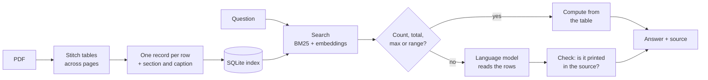

<div align="center">

# 📊 table-rag

**Ask questions about tables in technical PDFs, and get the exact number with its source, or an honest "not found"** ♡

<a href="https://github.com/namita-tj/table-rag/actions/workflows/ci.yml"></a>


[What it is](#-what-it-is) · [Why](#-why) · [Results](#-results) · [Quick start](#-quick-start) · [How it works](#-how-it-works) · [Can and can't](#-what-it-can-and-cant-do) · [Docs](#-where-to-find-what)

</div>

### 🤔 What it is
A retrieval-augmented generation (RAG) pipeline built for **tables** in technical and scientific PDFs: datasheets,
specifications, reports. You index your PDFs once, then ask questions in plain English. Every answer comes with the
document, page and table row it came from.

**For:** engineers and researchers who need numbers they can trust, and anyone comparing table-RAG approaches.

### ✨ Why
In technical documents, the important facts are in tables: pressure limits, speed ranges, tolerances, test
parameters, revenue figures. Most RAG pipelines are built for text, and tables break them:

- **Tables get split.** A table that runs across two pages becomes two pieces, and the second one has no header,
  so `10 | 8 | 1450` is just numbers.
- **Rows lose their context.** A row like "Stage 5" means nothing without its section. The datasheet may have ten
  products, each with its own Stage 5.
- **Language models guess.** Given the wrong row, or half a table, the model still answers, and it sounds sure.

**Why this matters:** the wrong answer is rarely absurd. It's a real number from the same document, just from the
wrong row: 8 bar instead of 10 bar, the limit of the neighbouring product. It looks right, so nobody checks it.
The engineer who uses it to set up a test, size a part or sign off a spec can damage equipment, fail a
certification or build the wrong thing. And if every answer has to be checked against the PDF anyway, the tool
saves no time at all.

So a tool for these documents has to do two things: **find the right row**, and **say "not found" rather than
guess**. I built table-rag to see how far a table-aware pipeline gets on both, and measured it against the
usual approaches.

### 📈 Results
Every method got the same search, the same language model (Qwen2.5-3B) and the same amount of text. Only the way
tables are read and answered differs.

| Method | Datasheets: correct | Datasheets: wrong | Financial reports: correct | Financial reports: precision |
| --- | ---: | ---: | ---: | ---: |
| Docling | 37.1% | 52.8% | 21.5% | 25.8% |
| Fixed-size chunks | 32.1% | 60.2% | 19.6% | 23.0% |
| **table-rag** | **94.8%** | **3.4%** | **29.9%** | **40.0%** |

**In short:** on datasheets, 2.5 times as many right answers as Docling, with wrong answers down from 53% to 3%.
Financial reports are harder, because most questions need a calculation, but it's still the best method there.
*Precision* is the share of answers that are right, counting only the questions it did answer.
The setup, all methods and the limits of the comparison are in [docs/benchmark.md](docs/benchmark.md).

### 🚀 Quick start
Needs Python 3.11 or newer.

```bash
git clone https://github.com/namita-tj/table-rag.git && cd table-rag
pip install -e .

python -m tablerag.bench.synthetic_docs example        # no PDFs at hand? this makes a sample datasheet
tablerag index example --db index.db                    # read the PDFs into one SQLite file
tablerag ask "Which stage of the PX-100 covers 1450 rpm?" --db index.db
```
```
Answer: Stage 7   (structured)
Because: 1450 rpm lies in Stage 7 of 4.1 PX-100 - Compact pump
Source: example_datasheet, page 4, Table 4.1-1: Operating points (4.1 PX-100 - Compact pump)
  Stage: Stage 7; Speed [rpm]: 1380 - 1963; Duty: Intermittent; Max. pressure [bar]: 4
```

- Use your own PDFs by pointing `tablerag index` at their folder. Indexing again only reads new or changed files.
- Without a language model, counts, totals, maximums and range lookups are answered; other questions show the best
  evidence. Add `--reader Qwen/Qwen2.5-3B-Instruct` for full answers (`pip install -e ".[gpu]"`, a GPU helps).
- `--json` gives the answer as JSON, and `tablerag info --db index.db` shows what's indexed.

<details>
<summary><b>🐍 Use it from Python</b></summary>

```python
from pathlib import Path

from tablerag.answer import answer_questions
from tablerag.ingest.structured import ingest_structured
from tablerag.retrieve import BM25
from tablerag.store import Store

with Store("index.db") as store:
    store.index(Path("example").glob("*.pdf"), ingest_structured)
    chunks, tables = store.load()

answer = answer_questions(
    [{"question": "How many stages does the PX-100 define?", "doc_id": "example_datasheet"}],
    BM25(chunks), reader=None, tables=tables, mode="ours",
)[0]
print(answer.text, answer.route, answer.raw)   # 11 structured 11 rows in 4.1 PX-100 - Compact pump
```
`doc_id` is the PDF's file name without `.pdf`. Pass a reader (see `tablerag.answer.HFReader`) for questions the
table operations can't answer.
</details>

### 🔧 How it works
The idea: **treat a table as data, not as text.** Use code where precision matters, and the language model only
where flexibility is needed.

| Usual RAG | table-rag |
| --- | --- |
| Cuts the PDF into fixed-size text chunks, often through the middle of a table | Joins tables split across pages, then stores one record per row |
| A row is stored without its header or section | Every row carries its column names, section and caption |
| The language model reads the numbers and does the maths | Counts, totals, maximums and range lookups are computed in code |
| Whatever the model says is the answer | Every value must be printed in the source, otherwise "not found" |
| Calculations are trusted as written | The model writes a formula, the code computes it, and every number in it must come from the source |



1. **Keep tables intact:** tables split across pages are joined, and every row is stored with its section and caption.
2. **Retrieve rows, not fragments:** one chunk per row, found with keyword search plus embeddings.
3. **Compute what can be computed:** counts, totals, maximums and range lookups come straight from the table.
4. **Check every answer:** a value must be printed in the source. For calculations, the model writes the formula,
   the code computes it, and every number in it must be printed.

### ✅ What it can and can't do
| Works well | Not yet |
| --- | --- |
| Digital PDFs with ruled (grid) tables | Borderless tables, scanned pages, tables as images |
| Tables split across pages | Merged cells and multi-level headers |
| Exact counts, totals, maximums, range lookups | Checking the *logic* of a calculation, only its numbers |
| Answers with document, page and row | A web interface (command line and Python only) |

### 💡 What I learned
- **Row context matters most.** Without the section name on each row, finding the right row drops from 81% to 0%.
- **Small models can't do bookkeeping.** Asked to cite their sources, they refused almost everything, so the check moved into code.
- **Not every standard part helps.** A common reranker made table search worse; a stronger embedding model made it better.
- **Words change meaning between domains.** "Total" in a financial report isn't the sum of a column. A diagnostic caught it, and a test keeps it fixed.

### 📚 Where to find what
| I want to… | Look here |
| --- | --- |
| see every result, ablation and caveat | [docs/benchmark.md](docs/benchmark.md) |
| understand the design decisions | [docs/design.md](docs/design.md) |
| check the raw numbers | `results/` |
| read the code | `src/tablerag/`, with `bench/` for the benchmarks |
| run the tests and benchmark | `pip install -e ".[dev]"`, then `pytest` and `python -m tablerag.bench.run` |

Every push runs the tests and a **benchmark gate** that blocks any change that makes the numbers worse.

### 🌱 What's next
Checking the logic of calculations, borderless tables and scans, and a small web interface.

<div align="center"><sub>build cool things that actually work ♡</sub></div>
